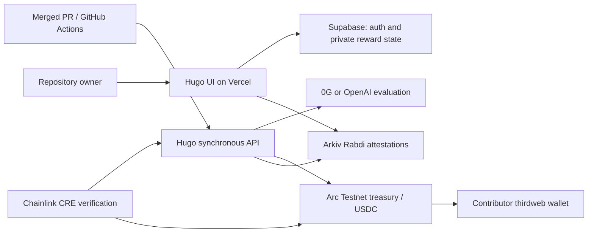

# Hugo

Hugo rewards open-source contributors after a pull request is merged. A repository owner funds a dedicated Arc Testnet treasury; Hugo evaluates contribution evidence, reserves a capped reward, and pays linked contributor wallets. Contributors can also claim reserved rewards after signing in. Arkiv provides public attestations, and a Chainlink CRE workflow verifies a reward report against Arc.

This is a testnet proof of concept. The backend trusts the post-merge workflow's submitted evidence and assumes the registrant owns the repository.

## Run locally

Requires Node.js 24 and npm.

```sh
cd app
npm ci
cp -n .env.example .env.local
npm run dev
```

Fill in `app/.env.local` using the keys below, then open [localhost:3000](http://localhost:3000). The schema for a fresh Supabase database is in `app/supabase/migrations/001_hugo.sql`. Deploy the app from the `app` directory on Vercel. Configure GitHub OAuth redirects and thirdweb's allowed domains for each app origin.

## API keys and configuration

| Service | Where to get it | Environment variables |
|---|---|---|
| Supabase | [Dashboard](https://supabase.com/dashboard): create a project, then open **Project Settings → API Keys**. Enable GitHub under **Authentication → Providers** using a [GitHub OAuth app](https://github.com/settings/developers). | `NEXT_PUBLIC_SUPABASE_URL`, `NEXT_PUBLIC_SUPABASE_ANON_KEY`, `SUPABASE_SERVICE_ROLE_KEY` |
| thirdweb | [Dashboard](https://thirdweb.com/dashboard): create a project and API keys; enable GitHub login for embedded wallets and add your app's domains. | `NEXT_PUBLIC_THIRDWEB_CLIENT_ID`, `THIRDWEB_SECRET_KEY` |
| AI inference | Choose [0G Private Computer](https://pc.0g.ai/dashboard/api-keys) or [OpenAI](https://platform.openai.com/api-keys); choose an available model. | `AI_PROVIDER=0g` with `OG_API_KEY` and `OG_MODEL`, or `AI_PROVIDER=openai` with `OPENAI_API_KEY` and `OPENAI_MODEL` |
| Arc Testnet | Create a separate backend test wallet and fund it with test USDC from the [Circle faucet](https://faucet.circle.com/). The owner creates the treasury through Hugo. | `PAYOUT_VOUCHER_SIGNER_KEY`, `NEXT_PUBLIC_ARC_RPC_URL`; `NEXT_PUBLIC_TREASURY_ADDRESS` is optional |
| Arkiv Rabdi | Create an [access key](https://hub.arkiv.network/access-keys), create a test writer wallet, and fund it through the [Arkiv faucet](https://hub.arkiv.network/faucet). | `ARKIV_ACCESS_KEY`, `ARKIV_WRITER_PRIVATE_KEY`, `ARKIV_ISSUER_ADDRESS` |
| Chainlink CRE | [Create an account](https://app.chain.link/cre/discover), install the [CRE CLI](https://docs.chain.link/cre/getting-started/cli-installation/macos-linux), and run `cre login`. Set the same report token in Vercel and `app/cre/.env`; browser login needs no `CRE_API_KEY`. | `CRE_EXTERNAL_REPORT_TOKEN` |

Set `NEXT_PUBLIC_APP_URL` to the app origin. Generate distinct random values for `MERGE_TRIGGER_SECRET`, `WORKER_API_SECRET`, and `CRE_EXTERNAL_REPORT_TOKEN`, for example with `openssl rand -hex 32`. Set the matching GitHub Actions secrets in the registered repository as described in [the integration example](examples/github/README.md). No GitHub PAT is required by Hugo.

Set the required values in Vercel's environment settings and redeploy after changes. Keep server keys and wallet private keys out of Git and browser-side variables. Free tiers and testnet faucets have limits; AI inference requires available credits.

## Verify

### Useful pages

Production origin: `https://hugo-three-amber.vercel.app`. Replace `<project-id>` with the UUID shown in your project's URL and `<treasury-address>` with its Arc contract address.

| Page | Link / path | Access |
|---|---|---|
| Home | [Open Hugo](https://hugo-three-amber.vercel.app/) | Public |
| Owner workspace | [Open admin](https://hugo-three-amber.vercel.app/admin) | Owner GitHub login |
| Register repository | [New project](https://hugo-three-amber.vercel.app/admin/projects/new) | Owner login |
| Project funding and rewards | `/admin/projects/<project-id>` | Project owner |
| Start / stop funding | `/admin/projects/<project-id>/settings` | Project owner |
| Contributor login, claims and withdrawal | [Open redeem](https://hugo-three-amber.vercel.app/redeem) | GitHub through thirdweb |
| Public attestations | [Open Arkiv](https://hugo-three-amber.vercel.app/arkiv) | Public |
| Donate to a known treasury | `/support/<treasury-address>` | Public; wallet needed to donate |

### Useful API routes

GET links below can be opened in a browser. Protected endpoints require the indicated session or bearer token. POST routes are called by the UI, integration workflow or publishing script, not by opening a browser link.

| Method | URL / path | Purpose / access |
|---|---|---|
| GET | [Health](https://hugo-three-amber.vercel.app/api/health) | Public database/Arc connectivity check |
| GET | [Arkiv contributions](https://hugo-three-amber.vercel.app/api/arkiv/contributions) | Public live contribution query |
| GET | [Arkiv programs](https://hugo-three-amber.vercel.app/api/arkiv/programs) | Public live project attestation query |
| GET | `/api/cre/report/<reservation-id>` | CRE reward report; bearer `CRE_EXTERNAL_REPORT_TOKEN` |
| GET | `/api/me` | Owner identity and linked wallets; owner session |
| GET | `/api/projects` | Signed-in owner's projects |
| GET | `/api/projects/<project-id>` | Project funding state; owner session |
| GET | `/api/projects/<project-id>/rewards` | Reservations and payout references; owner session |
| GET | `/api/contributor/allocations` | Unclaimed confirmed allocations; contributor session |
| POST | `/api/merge/github` | Evaluate merged PR and process reward; bearer `MERGE_TRIGGER_SECRET` |
| POST | `/api/internal/arkiv/sync` | Publish queued attestation; bearer `WORKER_API_SECRET` |
| POST | `/api/projects/prepare`, `/api/projects` | Prepare and register treasury; owner session |
| POST | `/api/projects/<project-id>/funding-confirm`, `/api/projects/<project-id>/funding-state-confirm` | Confirm funding transaction; owner session |
| POST | `/api/wallet/challenge`, `/api/wallet/verify` | Bind owner wallet; owner session |
| POST | `/api/contributor/challenge`, `/api/contributor/verify` | Establish contributor wallet session |
| POST | `/api/contributor/allocations/<allocation-id>/claim` | Claim reserved reward; contributor session |

The reservation ID is a reward UUID, not a project UUID or transaction hash. The current CRE example uses `1fbe33a9-49fa-4ff8-a96f-d6c40b573719`. Authentication callbacks use `/auth/callback`; start login through the UI rather than opening that callback manually.

- `/api/health` checks database and Arc connectivity.
- `/arkiv` displays live public attestations when Arkiv is configured and records have been published.
- The CRE workflow in `app/cre` can be simulated with the Chainlink CLI; network deployment requires Chainlink access approval.

Use your project's Arc Testnet and Arkiv Rabdi explorer links to inspect deployed contracts and transactions. The contract and assets are for testnet only.

## Demo commands

Run each block from the repository root.

**Publish queued Arkiv attestations:**

```sh
cd app
node --env-file=.env.local --import tsx scripts/arkiv-sync.ts
cd ..
```

`app/.env.local` must contain `POC_APP_URL` for the hosted app and the matching `WORKER_API_SECRET`. The hosted app needs its Arkiv settings. The script prints entity keys and transaction hashes, or says the queue is up to date. See the live records at `/arkiv`.

**Simulate CRE verification:**

```sh
cd app/cre
cre workflow simulate ./workflow --target staging-settings
cd ../..
```

Install Bun and the CRE CLI, run `cre login`, and set `CRE_EXTERNAL_REPORT_TOKEN` in `app/cre/.env` to match Vercel. `app/cre/workflow/config.staging.json` must point to a confirmed reservation report and its Arc treasury. Select the cron trigger if prompted. A successful run prints `CRE_VALIDATED`; it is a local simulation that reads the hosted API and Arc, not a hosted CRE deployment.

## Community

See [Contributing](CONTRIBUTING.md), the [Code of Conduct](CODE_OF_CONDUCT.md), and [Security](SECURITY.md). Hugo is licensed under the [MIT License](LICENSE).

## Architecture and submission evidence



Live app: https://hugo-three-amber.vercel.app · [Public attestations](https://hugo-three-amber.vercel.app/arkiv).

- [Arc treasury](https://explorer.testnet.arc.io/address/0xeea6446c0559f631692ab6ad09b5ee2f2cd642c8) · [Confirmed payout](https://explorer.testnet.arc.io/tx/0x60760c43545b468bfa99fba647597a1585756373fce8cf36dce1c98cad3b07b4).
- Arkiv writer: `0x112634b7dabb3af1862d802116dcc329ae1083ce` on Rabdi (7794095).
- [Program publication](https://rabdi.explorer.arkiv.network/tx/0x4d5c2237f581a0488c2ded7b32815ed71f7e3e1ddcb358c8248b586d00e920de) · [Contribution publication](https://rabdi.explorer.arkiv.network/tx/0xa5a7f62e4b15869adee4f34839562eaf22c9eeb0e7eea57fdd66ca15fb097d5f).

Run this live Arkiv query without app login:

```sh
curl --fail --silent --show-error https://hugo-three-amber.vercel.app/api/arkiv/contributions
```

The endpoint queries Arkiv by issuer ownership, `project=proof-of-contribution`, and `kind=Contribution`; it returns the latest revision per subject among fetched results. See [SDK query/schema implementation](app/src/server/arkiv.ts) and [Arkiv criterion documents](arkiv/schema.md). Publication is manually triggered with the command above; it is not automatic after every merge.

AI disclosure: OpenAI Codex assisted with implementation, debugging and documentation. Runtime contribution evaluation uses the explicitly selected AI provider. Its output is validated, while monetary allocation is calculated in code. No specific 0G request is claimed without its recorded provider and request ID.

See [checklist.md](checklist.md) for qualification evidence and outstanding manual steps, including Arc Studio, public repository access and the demo video.
